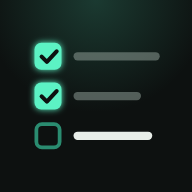
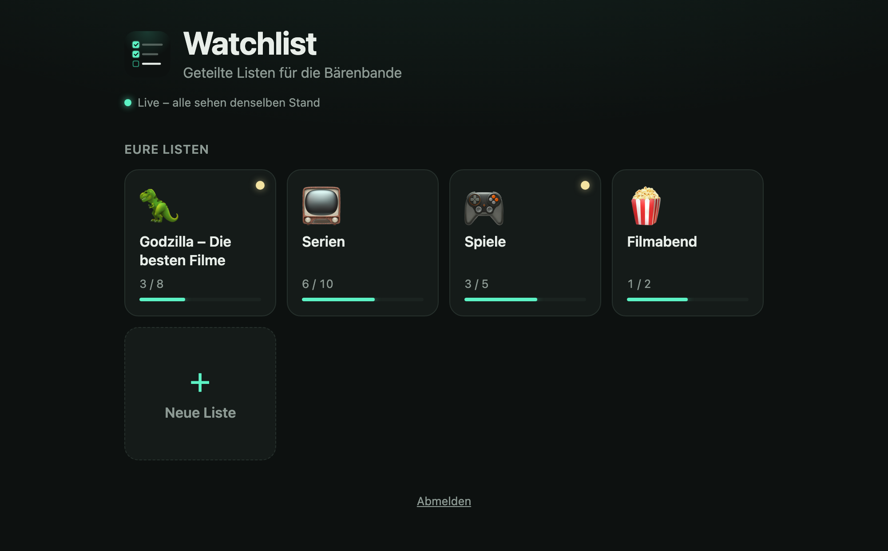
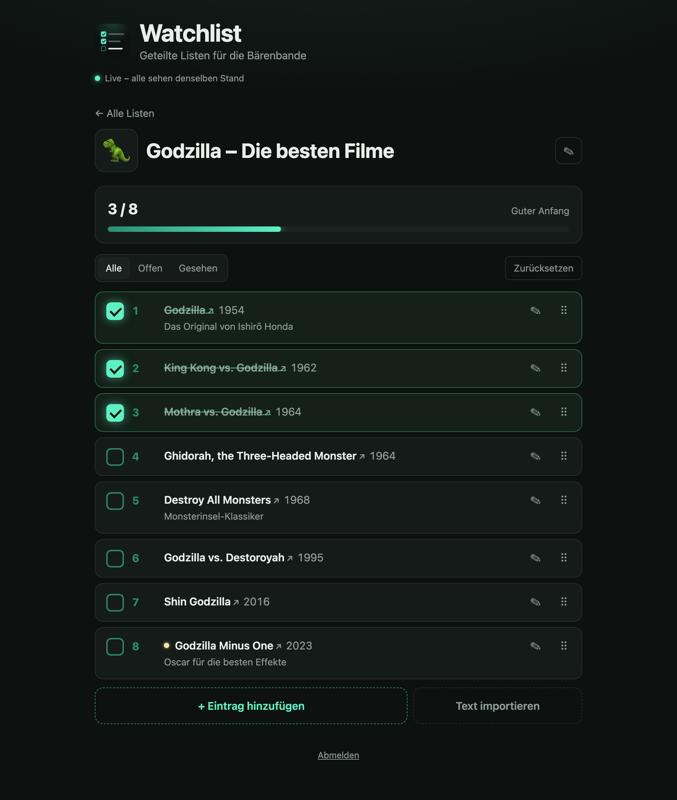

<p align="center">
  
</p>

<h1 align="center">Watchlist</h1>

<p align="center">
  Geteilte Listen für Filme, Serien und Spiele – live synchron für alle, auf Handy und Computer.<br>
  <a href="https://burni2001.github.io/watchlist/"><strong>burni2001.github.io/watchlist</strong></a>
</p>

<p align="center">
  
</p>

## Worum geht's?

Eine kleine Web-App, mit der eine Gruppe gemeinsam abhakt, was sie schon gesehen oder gespielt hat. Wenn jemand einen Haken setzt, sehen das alle anderen sofort, ohne die Seite neu laden zu müssen. Der Zugang ist mit einem gemeinsamen Passwort geschützt.

## Funktionen

- **Mehrere Listen** auf der Startseite als Kacheln, jede mit einem frei wählbaren Emoji und Fortschrittsbalken.
- **Live-Abgleich:** Haken, neue Einträge und Umsortierungen erscheinen sofort bei allen.
- **Einträge verwalten:** hinzufügen, bearbeiten (Titel, Jahr, Notiz, Link), löschen und per Ziehen oder mit den Pfeiltasten umsortieren.
- **IMDb-Knopf:** setzt mit einem Klick einen Suchlink zum Titel.
- **Text-Import:** eine einfache Textliste einfügen oder als Datei laden, um daraus eine neue Liste zu machen oder eine bestehende zu ergänzen. Jahreszahlen wie „Alien (1979)“, Links und Häkchen wie `[x]` werden erkannt, auf Wunsch bekommt jeder Eintrag einen IMDb-Suchlink.
- **Neu-Markierung:** Ein blassgelber Punkt auf der Kachel und vor dem Eintrag zeigt, was seit dem letzten Besuch dazugekommen ist. Jedes Gerät merkt sich das selbst.
- **Filter:** Alle, Offen oder Gesehen.
- **Handy-tauglich:** lässt sich auf dem iPhone oder unter Android auf den Home-Bildschirm legen und läuft dann wie eine App im Vollbild.

<p align="center">
  
</p>

<sub>Die Screenshots zeigen Beispieldaten.</sub>

## Technik

- **Eine einzige Datei** (`index.html`) mit HTML, CSS und JavaScript, ohne Framework und ohne Build-Schritt.
- **Hosting:** GitHub Pages.
- **Daten, Anmeldung und Live-Updates:** [Supabase](https://supabase.com) (Postgres, Auth, Realtime).
- **Bibliotheken** werden per CDN mit Integritätsprüfung geladen: [supabase-js](https://github.com/supabase/supabase-js) und [SortableJS](https://github.com/SortableJS/Sortable).

| Datei | Inhalt |
| --- | --- |
| `index.html` | Die komplette App |
| `supabase-setup.sql` | Tabellen, Zugriffsregeln und Live-Updates für Supabase |
| `icon.svg`, `icon-*.png`, `manifest.webmanifest` | App-Icon und Angaben für den Home-Bildschirm |
| `docs/` | Screenshots für diese Seite |

## Sicherheit

Alle teilen sich einen Benutzer in Supabase. Die Zugriffsregeln (Row Level Security) erlauben Lesen und Schreiben nur diesem einen Benutzer. Ohne Anmeldung gibt es keinen Zugriff auf die Daten.

Der Supabase-Schlüssel in `index.html` ist der öffentliche „Publishable Key“. Er darf im Code stehen, weil die Rechte in der Datenbank geregelt sind.

## Eigene Instanz aufsetzen

1. **Projekt anlegen:** In [Supabase](https://supabase.com) ein Projekt erstellen.
2. **Benutzer anlegen:** Unter *Authentication → Users → Add user* einen Benutzer mit eigenem Passwort anlegen und *Auto Confirm User* einschalten.
3. **Datenbank einrichten:** Die Benutzer-ID in `supabase-setup.sql` ersetzen und das Skript im *SQL Editor* ausführen.
4. **App verbinden:** In `index.html` die Werte `SUPABASE_URL`, `SUPABASE_KEY` (Publishable Key) und `LOGIN_EMAIL` anpassen.
5. **Veröffentlichen:** Das Repo auf GitHub Pages veröffentlichen (*Settings → Pages → Branch `main`, Ordner `/`*).
6. **Registrierung abschalten (empfohlen):** In Supabase unter *Authentication → Sign In / Providers* die öffentliche Registrierung deaktivieren.

**Lokal testen:**

```bash
python3 -m http.server 8765
```

Danach http://localhost:8765 öffnen.

> **Hinweis:** Kostenlose Supabase-Projekte werden nach etwa einer Woche ohne Nutzung pausiert. Im Supabase-Dashboard lassen sie sich mit einem Klick wieder starten.
